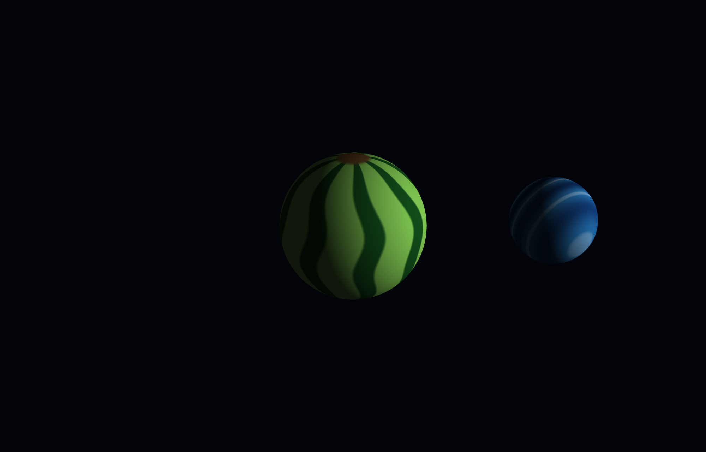

# 3주차 과제 2 설명 노트 — 수박 행성과 파도 바다 행성

[`task2.html`](task2.html)을 **직접 설명할 수 있게** 정리한 노트입니다. 강의에서 8주차 이후 면담 때 "본인이 쓴 줄을 지목해 설명"하라고 했으니, 아래 내용을 자기 말로 말할 수 있으면 됩니다.



---

## 1. 무엇이 바뀌었나 (실습 1 → 실습 2)

| 부분 | 바꾼 내용 |
|---|---|
| 버텍스 셰이더 | `vSurf = aNormal;`: 돌리기 전 법선을 프래그먼트 셰이더로 보냄 (기존에 이미 있었음) |
| 프래그먼트 셰이더 | **전부 새로 작성.** `uPlanet` 값에 따라 수박 무늬와 바다 물결 무늬 중 하나를 계산 |
| JavaScript | `uPlanet` uniform 추가, 바닥 제거, 배경을 어둡게, 행성 2개 그리기 (바다 행성은 공전) |
| 카메라 | 마지막 크기 조절 `3.4` → `2.0` (행성을 크게 보이게) |

**이미지 파일은 하나도 쓰지 않았습니다.** 무늬는 전부 `sin`, `smoothstep`, `mix`, `distance` 계산으로 만들었습니다.

---

## 2. 공통 준비 — 모든 무늬의 재료

```glsl
vec3 N = normalize(vNormal);   // 세계 기준 법선 → 빛 계산용 (행성이 돌면 같이 돈다)
vec3 S = normalize(vSurf);     // 물체 기준 법선 → 무늬 계산용 (돌리기 전 값)
float diff = max(dot(N, L), 0.0); // 낮과 밤: 빛과 같은 쪽을 보면 1, 등지면 0
float lat = S.y;               // 위도: −1(남극) ~ 1(북극)
float lon = atan(S.z, S.x);    // 경도: −π ~ π (구를 한 바퀴 도는 각도)
```

**왜 N과 S를 따로 쓰나?** (면담 단골 질문)
- 무늬를 N(세계 기준)으로 계산하면, 행성이 돌아도 무늬는 세계에 고정되어 **행성만 미끄러지듯** 돕니다.
- 무늬를 S(물체 기준, 회전 전 값)로 계산하면 **무늬가 표면에 붙어서 함께 돕니다.**
- 빛은 세계에 고정된 태양에서 오므로, 빛 계산은 N으로 해야 낮/밤 경계가 제자리에 있습니다.

**구 위의 점 = 법선 방향**: 반지름 1인 구에서는 표면 위치와 법선이 같습니다. 그래서 `S.y`를 바로 높이(위도)로 쓸 수 있습니다.

---

## 3. 수박 행성 — 식과 이유

```glsl
float stripe = sin(lon * 8.0 + sin(lat * 6.0) * 0.6);
float dark = smoothstep(0.2, 0.6, stripe);
albedo = mix(lightGreen, darkGreen, dark);
float stem = smoothstep(0.965, 0.985, lat);
albedo = mix(albedo, vec3(0.40, 0.26, 0.12), stem);
```

**① 세로 줄무늬 `sin(lon * 8.0)`**
- 경도 `lon`은 적도를 따라 한 바퀴 돌면 −π에서 π까지 변합니다.
- `sin(lon * 8)`은 그동안 **8번 오르내리므로 줄이 8개** 생깁니다.
- 경도가 같은 점들(극에서 극으로 이어진 세로선)은 값이 같아서 **세로 줄**이 됩니다.
- 강의 예시의 가스 행성은 위도(`lat`)에 sin을 걸어 **가로 띠**를 만들었습니다. 이 행성은 **경도에 걸어서 방향이 반대**입니다.

**② 구불거림 `+ sin(lat * 6.0) * 0.6`**
- 줄이 자로 잰 듯 곧으면 수박 같지 않습니다.
- 위도에 따라 −0.6~+0.6만큼 각도를 더해 **줄을 좌우로 밀면 지그재그**가 됩니다.
- `6.0`은 위아래로 몇 번 구불거리는지, `0.6`은 얼마나 크게 흔들리는지를 정합니다.

**③ 두 색 섞기 `smoothstep(0.2, 0.6, stripe)` → `mix`**
- `stripe`는 −1~1 사이 값입니다. 0.2보다 작으면 0(연두), 0.6보다 크면 1(진초록), 그 사이는 부드럽게 변합니다.
- 기준을 0이 아니라 0.2~0.6으로 잡았기 때문에 **진초록 줄이 연두 바탕보다 가늘게** 나옵니다. 실제 수박처럼 보이게 하려는 의도입니다.
- `mix(a, b, t)`는 t = 0이면 a, 1이면 b, 그 사이면 비율대로 섞습니다.

**④ 꼭지 `smoothstep(0.965, 0.985, lat)`**
- 위도가 0.965보다 큰 곳, 즉 **북극 바로 근처**만 1이 되어 갈색으로 칠해집니다.

**숫자를 바꿔 보며 확인할 것** (면담 때 "이 숫자를 바꾸면?" 질문 대비)

| 바꾸기 | 예상 결과 |
|---|---|
| `8.0` → `4.0` | 줄이 4개로 줄고 굵어짐 |
| `0.6` → `0.0` | 구불거림이 사라지고 곧은 세로줄 |
| `smoothstep(0.2, 0.6, …)` → `(0.0, 0.05, …)` | 경계가 칼같이 또렷해지고 줄이 굵어짐 |
| `lon` 대신 `lat` | 가로 띠가 됨 (가스 행성과 비슷해짐) |

---

## 4. 파도 바다 행성 — 식과 이유

```glsl
vec3 C = normalize(vec3(1.0, 0.3, 0.0));
float d = distance(S, C);
float wave = sin(d * 16.0 - uTime * 3.0);
float fade = 1.0 - 0.6 * smoothstep(0.0, 2.0, d);
albedo = mix(deepSea, lightSea, 0.5 + 0.5 * wave * fade);
float foam = smoothstep(0.85, 1.0, wave) * fade;
albedo = mix(albedo, vec3(0.92, 0.96, 1.0), foam * 0.8);
```

**① 물방울이 떨어진 점 C와 거리 d**
- 표면 위 한 점 C를 정하고, 각 픽셀이 C에서 얼마나 떨어져 있는지 `distance`로 잽니다.
- 구 위의 점이라 d는 0(C 위치)부터 2(정반대편)까지입니다.

**② 동심원 `sin(d * 16.0)`**
- C에서 **거리가 같은 점들은 sin 값도 같습니다.** 그래서 C를 중심으로 한 **원 모양 줄**이 생깁니다. 호수에 돌을 던졌을 때의 물결과 같습니다.
- `16.0`은 물결 간격입니다. 클수록 촘촘해집니다.

**③ 퍼져 나가는 움직임 `− uTime * 3.0`** (`uTime` 사용 조건)
- 시간이 지나면 sin 안의 값이 줄어듭니다. 그래서 **같은 값(예: 물결 마루)이 나오는 거리 d가 점점 커집니다.**
- 즉 물결이 **중심에서 바깥으로 퍼져 나갑니다.** `3.0`은 속도입니다.
- 부호를 `+`로 바꾸면 물결이 **중심으로 모여듭니다.**

**④ 멀어질수록 약하게 `fade`**
- 중심(d = 0)에서는 1, 정반대편(d = 2)에서는 0.4입니다. 실제 물결처럼 멀리 갈수록 약해집니다.
- 처음에는 0까지 줄였더니 **행성 대부분에서 물결이 안 보였습니다.** 그래서 0.4까지만 줄이도록 고쳤습니다(아래 6절 시행착오).

**⑤ 마루는 밝게, 골은 어둡게 + 거품**
- `0.5 + 0.5 * wave`는 −1~1을 0~1로 바꾸는 식입니다. 이 값으로 깊은 색과 밝은 색을 섞습니다.
- `smoothstep(0.85, 1.0, wave)`는 wave가 거의 1인 **물결 꼭대기에만** 흰 거품을 얹습니다.

| 바꾸기 | 예상 결과 |
|---|---|
| `16.0` → `40.0` | 물결이 아주 촘촘해짐 |
| `uTime * 3.0` → `uTime * 0.5` | 천천히 퍼짐 |
| `- uTime` → `+ uTime` | 물결이 중심으로 모여듦 |
| `0.6` (fade) → `1.0` | 정반대편에서 물결이 사라짐 |

---

## 5. 두 행성을 그리는 방법 (JavaScript)

**같은 셰이더, uniform만 다르게**: 강의에서 허용한 방법입니다("같은 셰이더에 uniform 값만 바꿔도 되고").

```js
gl.uniform1i(uPlanetLoc, 0);   // 수박 무늬로 → 그리기
gl.uniform1i(uPlanetLoc, 1);   // 바다 무늬로 → 그리기
```

**바다 행성의 공전**: 2주차의 `R · T` 순서를 그대로 썼습니다. 행렬은 **오른쪽부터** 적용됩니다.

```js
let seaModel = M4.scale(0.6, 0.6, 0.6);                    // ① 크기 0.6배
seaModel = M4.multiply(M4.rotateY(time * 1.2), seaModel);  // ② 제자리 자전 (아직 원점에 있으므로)
seaModel = M4.multiply(M4.translate(3.6, 0, 0), seaModel); // ③ 오른쪽으로 3.6 밀어냄
seaModel = M4.multiply(M4.rotateY(time * 0.4), seaModel);  // ④ 원점을 중심으로 돌림 → 공전
seaModel = M4.multiply(M4.translate(0, 1.1, 0), seaModel); // ⑤ 수박과 같은 높이로 올림
```

- ③ 밀어낸 **뒤에** ④ 돌리면, 이미 바깥에 있는 물체가 원점을 중심으로 돌게 되어 **공전**합니다.
- 순서를 바꿔 ④ 회전을 먼저 하면 원점에서 제자리 회전만 하고, 그다음 옆으로 옮겨질 뿐 **공전하지 않습니다.** 2주차 과제의 핵심 내용입니다.

---

## 6. 시행착오 (보고서에 쓰면 좋은 내용)

강의에서 "실패한 시도와 그 이유를 쓴 보고서를 더 높게 본다"고 했습니다. 실제로 만들면서 고친 것들입니다.

1. **처음 아이디어는 "눈이 달린 표정 행성"이었습니다.** 눈의 위치·흰자·동공·입을 각각 `distance`와 `smoothstep`으로 계산하다 보니 코드가 길고 설명하기 어려워서, 식 하나로 무늬가 나오는 수박 행성으로 바꿨습니다.
2. **낮과 밤 경계가 안 보였습니다.** 빛 방향 `L`이 카메라와 거의 같은 쪽이라 보이는 면이 전부 낮이었습니다. 그래서 `L`을 오른쪽 뒤 `(1.0, 0.35, −0.3)`로 옮겨 왼쪽에 밤이 보이게 했습니다.
3. **바다 행성에 물결이 거의 안 보였습니다.** 원인은 두 가지였습니다.
   - `fade`를 0까지 줄여서 중심에서 먼 곳은 물결이 사라졌습니다.
   - 물결 간격(`30.0`)이 작은 행성에 비해 너무 촘촘했습니다.
   - 그래서 `fade`를 0.4까지만 줄이고, 간격을 `16.0`으로 넓히고, 두 바다색의 대비를 키웠습니다.
4. **행성이 너무 작게 보였습니다.** 카메라 마지막 단계의 크기 조절 값 `3.4`를 `2.0`으로 줄여 화면에 담는 범위를 좁혔습니다(확대 효과).

---

## 7. 면담 예상 질문과 답

| 질문 | 답의 요점 |
|---|---|
| 무늬를 왜 `vSurf`로 계산했나요? | 회전 전 법선이라 무늬가 표면에 붙어서 같이 돕니다. `vNormal`로 하면 무늬가 세계에 고정됩니다. |
| 줄무늬가 왜 8개인가요? | 경도가 한 바퀴(2π) 도는 동안 `sin(lon*8)`이 8번 오르내리기 때문입니다. |
| 왜 줄이 구불구불한가요? | 위도에 따라 `sin(lat*6)*0.6`만큼 경도를 밀어서, 높이마다 줄 위치가 달라지기 때문입니다. |
| `smoothstep(0.2, 0.6, x)`가 뭔가요? | x가 0.2 이하면 0, 0.6 이상이면 1, 그 사이는 부드럽게 0→1로 바뀝니다. 두 색의 경계를 부드럽게 합니다. |
| 물결이 왜 원 모양인가요? | 중심 C까지 거리가 같은 점들은 `sin(d*16)` 값이 같아서 원을 이룹니다. |
| 물결이 왜 바깥으로 퍼지나요? | `− uTime*3`으로 시간이 갈수록 같은 위상이 더 큰 d에서 나오기 때문입니다. |
| 낮/밤은 어디서 생기나요? | `max(dot(N, L), 0.0)`. 빛을 등진 면은 내적이 음수라 0이 되고, `0.12`의 주변광만 남습니다. |
| 공전은 어떻게 했나요? | 오른쪽으로 밀어낸(`translate`) 뒤에 회전(`rotateY`)시켰습니다. 순서를 바꾸면 공전하지 않습니다. |
| 행성 두 개를 어떻게 다르게 칠했나요? | 같은 셰이더에 `uPlanet` uniform으로 0/1을 넘기고 `if`로 갈랐습니다. |
| 경도 −π와 π가 만나는 곳에 이음매가 없나요? | `lon*8`은 그 경계에서 16π만큼 차이 나는데, sin은 2π마다 같은 값이라 이어집니다. |

---

## 8. 보고서(`w3.md`) 초안 — 자기 말로 고쳐 쓰세요

> 아래는 뼈대입니다. 강의에서 "의도와 방법"을 반드시 쓰라고 했으니, 문장은 본인 표현으로 바꾸고 캡처를 더 넣으세요.

```markdown
## Task 2 — 수박 행성과 파도 바다 행성

- 실행: [Task 2](task2.html) · [인터넷에서 실행](https://dbswogus.github.io/cg_2026/week3/task2.html)


### 의도
- 우주에 떠 있는 "수박"과, 그 주위를 도는 "물결이 퍼지는 바다 행성"을 만들고 싶었다.
- 예시의 가스 행성은 위도로 가로 띠를 만들었지만, 나는 경도로 세로 줄을 만들어 방향을 바꿨다.
- 바다 행성은 한 점에서 물결이 계속 퍼져 나가 "살아 있는" 느낌이 나도록 했다.

### 방법
(이 노트의 3·4절 식과 설명을 요약해서 각 3~4줄씩)

### 시행착오
(이 노트의 6절 중 실제로 겪은 것)
```
